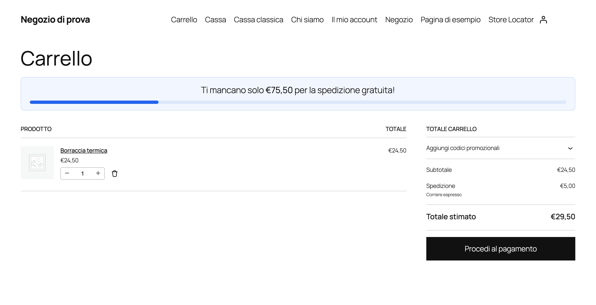
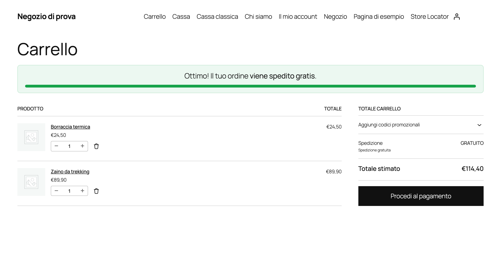
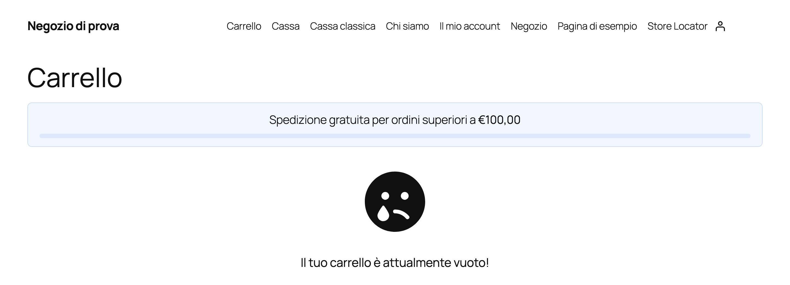
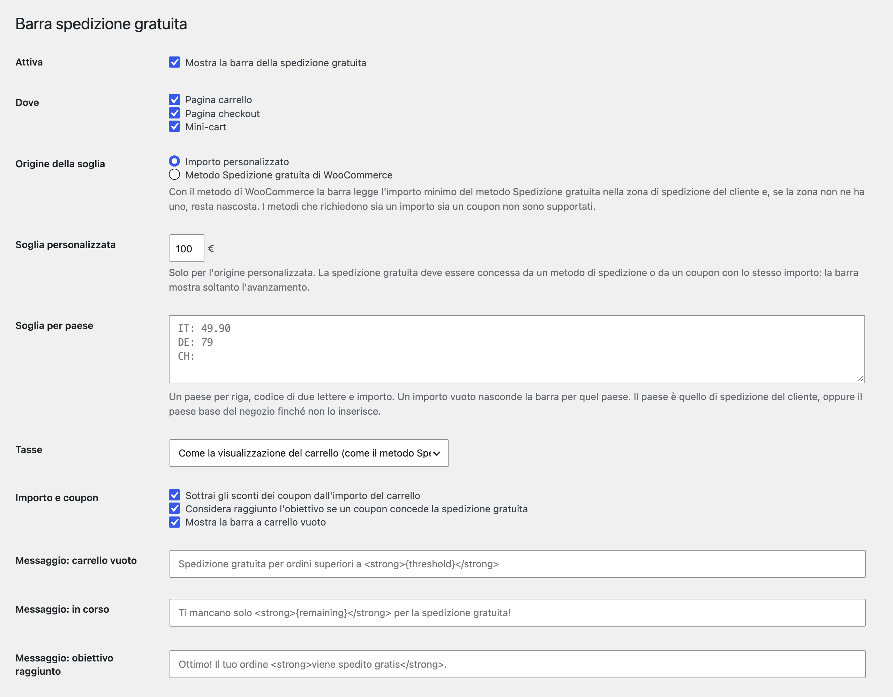

# Threecommerce Free Shipping Bar: free shipping progress bar for WooCommerce

A WooCommerce plugin that shows a progress bar towards free shipping with the amount still missing, updates when the customer changes the cart and confirms when the threshold is reached. It is the WooCommerce port of our Magento 2 free shipping bar.

**Compatibility:** WordPress 6.0+ · WooCommerce 8.0+ · PHP 8.1 – 8.4 · Block-based and classic cart/checkout · HPOS
**License:** free · **Current version:** see [Releases](../../releases)

## Features

- **Three states**: empty cart, in progress and reached.
- **Positions**: cart, checkout and mini-cart, both **block-based** and **classic** (shortcode and widget). Each one can be switched on or off.
- **Threshold**: a custom amount with a default plus exceptions per country (empty amount = no bar for that country), or the minimum amount of the WooCommerce **Free shipping** method of the zone matching the customer, honoring "Ignore discounts".
- **Amount** = displayed subtotal (tax included or excluded, your choice) minus coupon discounts, shipping excluded: the same formula as the Free shipping method.
- Optional: a coupon that grants free shipping marks the goal as reached.
- **Messages** per state with the `{remaining}` and `{threshold}` placeholders and limited HTML. English texts by default, Italian translation included.
- **Colors** from the panel or from your theme with the `--tc-fsb-color` and `--tc-fsb-reached` CSS variables.
- Compatible with **HPOS** and the Cart/Checkout blocks. No external JavaScript dependency.

## Requirements

- WordPress 6.0 or newer
- PHP 8.1 – 8.4
- WooCommerce 8.0 or newer (developed and tested on 10.9.4); the block-based cart and checkout need the WooCommerce Store API
- At least one active shipping method: WooCommerce treats a cart as "no shipping needed" when the store has none, and the bar does not appear (as with virtual-only carts)

## Installation

The plugin is free. Get the zip from the [product page](https://www.threecommerce.it/barra-spedizione-gratuita-woocommerce?utm_source=github&utm_medium=readme&utm_campaign=woocommerce-free-shipping-bar) (free order, then download it from My Account), then in WordPress go to **Plugins → Add New → Upload Plugin**, upload the zip and activate it.

## Configuration

WordPress admin → **WooCommerce → Free Shipping Bar**: where to show it, threshold source (custom amount or WooCommerce Free shipping method), per-country thresholds, tax handling, coupons, messages and colors.

## Documentation and support

- Product page and download: [threecommerce.it/barra-spedizione-gratuita-woocommerce](https://www.threecommerce.it/barra-spedizione-gratuita-woocommerce?utm_source=github&utm_medium=readme&utm_campaign=woocommerce-free-shipping-bar)
- [Changelog](CHANGELOG.md) (in Italian)
- Support and custom development: [threecommerce.it/contatti](https://www.threecommerce.it/contatti?utm_source=github&utm_medium=readme&utm_campaign=woocommerce-free-shipping-bar)

---

*This repository is the public showcase of the plugin. The source code is kept in a private repository.*
